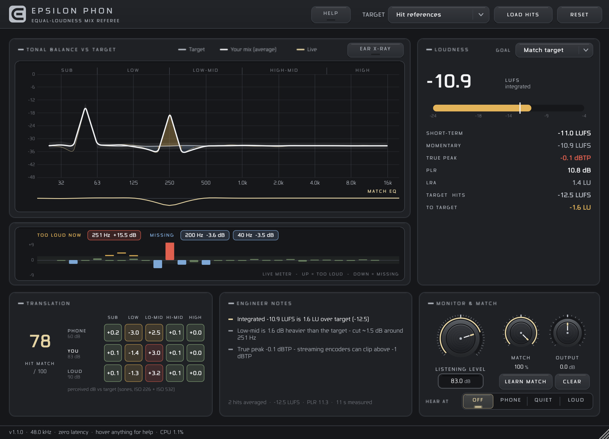
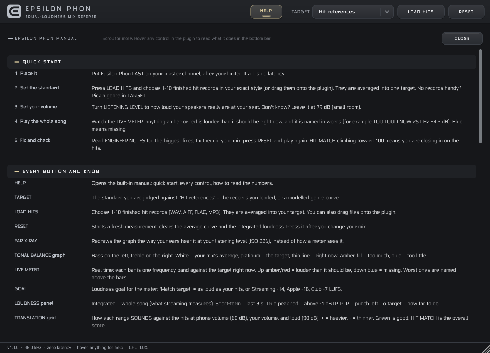

# Epsilon Phon — equal-loudness mix referee

## Install (no build needed)

**Mac (Intel and Apple Silicon):** download [Epsilon Phon for Mac](https://github.com/Epsilonmuz/Epsilon-Phon/releases/latest/download/Epsilon-Phon-macOS-Installer.pkg). Double-click it: the VST3 goes to `/Library/Audio/Plug-Ins/VST3`, the Audio Unit to `/Library/Audio/Plug-Ins/Components` and the standalone app to Applications. Then rescan in your DAW (FL Studio: Options > Manage plugins > Find installed plugins). The first time, macOS may say it can't check the installer (it isn't notarised by Apple): click Done, then System Settings > Privacy & Security > **Open Anyway**. No Terminal commands needed. The link always gives the newest build of `main`; it is rebuilt, test-installed on GitHub's Mac and replaced on every push.

Your ears change their EQ with volume (Fletcher-Munson, today ISO 226). Epsilon Phon measures your mix the way the hits are measured, then shows what you actually hear at your listening level and at phone / loud volumes.

**Put it last on your master, load 1–10 hit records in your lane, play your whole song.**

**Try the live view in your browser:** https://epsilonmuz.github.io/Epsilon-Phon/ (your audio file stays on your device).

**Download a build:** Actions → latest *Build Epsilon Phon (macOS)* run → artifact (VST3, AU, Standalone, INSTALL.txt). JUCE is not stored in the repo: CI fetches 9.0.5; for a local build run `git clone --depth 1 --branch 9.0.5 https://github.com/juce-framework/JUCE.git JUCE` in the repo folder first.

| Section | What it does |
|---|---|
| **Live meter (real time)** | Every band against the target *right now*: bars up (amber/red) = louder than it should be, down (blue) = missing, with peak-hold ticks. The worst offenders are named in words: `TOO LOUD NOW  251 Hz +4.2 dB`. Reacts within about a quarter of a second; gated in silence. |
| **Help (built-in manual)** | The HELP button opens a scrollable manual inside the plugin: quick start, every button and knob, how to read the numbers, colours, Fletcher-Munson in plain words. Hover any control and the bottom bar explains it. |
| Tonal balance vs target | Your mix's long-term third-octave balance (25 Hz–16 kHz) against the target, loudness-matched, with a live curve. Over = amber, under = blue. |
| Ear X-ray | Redraws everything through the ISO 226 contour at your listening level — what your ears hear, not what the meter sees. |
| Load hits / Target | Drop WAV/AIFF/FLAC (and MP3/M4A on macOS). Several records are averaged into one standard. Or pick a modelled genre curve: Trap, Drill, Dembow / Reggaeton, Hip-Hop, Pop, R&B, EDM, Rock. |
| Translation | Sub / Low / Low-mid / High-mid / High — how much heavier or thinner each range *sounds* than the hits at Phone (60 dB), You, and Loud (90 dB), in perceived dB (sones). Plus a Hit Match score /100. |
| Loudness · BS.1770 | Integrated, short-term, momentary LUFS, 4× true peak, PLR, LRA, against the hits' own LUFS or Streaming −14 / Apple −16 / Club −7. |
| Engineer notes | The biggest fixes in plain words (range + frequency + how many dB, loudness gap, squashed PLR, true peak, sub that vanishes on phones). |
| Learn match + Match | Learns a gentle 10-band octave EQ toward the target (max ±6 dB per octave). Match sets how much is printed. |
| Hear at | Phone / Quiet / Loud: hear your mix at another volume without touching your monitors (difference of two ISO 226 contours, loudness-matched). **Monitor only — turn it Off before bouncing.** |
| Listening level | Set to your calibrated monitor level (pink noise at −20 dBFS RMS → SPL meter at your seat, C-weighted). 79 dB small room, 83–85 dB large room. |

Zero latency. Analysis runs on a worker thread; the GUI caches its static layers (Intel-Mac friendly).

## Build

**Projucer:** open `Epsilon-Phon.jucer` (expects JUCE 9.0.5 in `JUCE/`), or open `Builds/MacOSX/Epsilon Phon.xcodeproj` directly. Every configuration is -O3 (Xcode Build/Run uses Debug).

**CMake:** `cmake -S . -B build -G Xcode && cmake --build build --config Release`

**Tests:** `PhonEngineTests` (ISO 226, spectrum, EBU loudness cases, true peak, EQ solver, comparisons, speed) and `PhonBench` (`-DPHON_BUILD_BENCH=ON`: real processor with hit references, learn match, hear-at, state round-trip, editor snapshots). pluginval strictness 8 passes.

## Research

ISO 226:2023 (≤0.6 dB from 2003 — Suzuki et al. 2024), Billboard Year-End Hot 100 study 2025 (2020 hits: −8.8 LUFS, PLR 9.3, darker / more low-mid), Pestana, Ma & Reiss AES 2013 (genre spectra). Built-in genre curves are models shaped from those averages; loaded references are the real standard.

Plugin code `EpPh`, manufacturer `EpsS` — keep them unchanged between versions so sessions reload.
